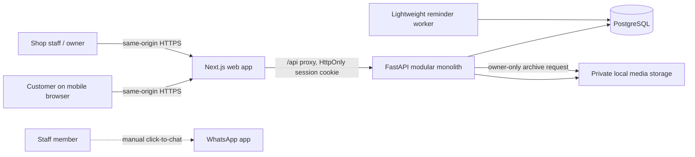

# System architecture

## Goals

Build an easy-to-use, mobile-first business platform for Durga Boutique and Dry Cleaning. It supports customer bookings and private order/payment views, garment-level shop operations, owner reporting, and optional customer notifications. English and Telugu are first-class languages. All business dates are interpreted in `Asia/Kolkata`, and money is stored as integer paise and displayed in INR.

## Architecture

Use a modular monolith. The frontend and API are separate applications in one repository, but business data and transactional rules live in one FastAPI service and one PostgreSQL database.



The same-origin `/api` proxy keeps browser requests and the API session cookie on one site. The opaque session cookie is `HttpOnly`, `Secure` in production, and `SameSite=Lax`; the database stores only an HMAC of the session secret. Mutating browser requests check the configured origin. Customer and staff authorization is checked in FastAPI for every record access.

## Implementation snapshot

The current starter includes the public landing and booking flows, customer registration/login and order views, customer QR generation, staff order/customer/catalogue workflows, garment intake photos, manual payments/refunds/expenses, analytics and CSV reports, daily closing, owner-only database/media export archives, notification preferences, and manual WhatsApp drafts. Its reminder worker writes deduplicated notification log entries for staff follow-up. The export archive has a seven-day download window but no one-click restore procedure. The API and models are a working foundation, not a release-certified service; see [known limits](../deployment/cost-and-deployment.md).

## Module boundaries

| Module | Owns |
| --- | --- |
| Identity and access | Customer/staff accounts, roles, permissions, sessions, recovery, QR lookup tokens |
| Catalog | Service categories, configurable services, price and turnaround snapshots |
| Booking and orders | Booking requests, customer approval of confirmed price/date, order lifecycle, timelines |
| Garments and files | Individual garment records, intake condition, private intake photos, file validation |
| Payments and expenses | Append-only payment/refund records, allocations, expense records |
| Notifications | Per-customer preferences, message templates, idempotent notification logs, reminder records, manual click-to-chat fallback |
| Analytics and closing | Permission-scoped aggregates, daily closing snapshots, CSV exports |
| Business settings and audit | Audit records, owner data export, and settings data model; owner settings UI/API remain future work |

The planned advisor is a read-only interface over named analytics functions. A deterministic rule-based advisor is not implemented yet; the current analytics screens and API return direct aggregates and do not call an AI model.

## Main operational flows

1. A customer may submit a booking request with a mobile number. The request contact is kept separately from a verified customer profile. Until staff verifies the person and physical garments, it remains a request and does not create a confirmed price or promise.
2. Staff identifies an existing customer by phone or by scanning their customer QR. The QR contains a random, revocable lookup token and is useful only to authenticated staff; it is not a login credential and does not expose customer data.
3. Staff records each garment, its condition, optional intake photos, and proposed services. The API snapshots prices and the expected delivery date. The customer must approve changed price/date before work is confirmed.
4. Order status changes are validated and appended to history. Events that may need follow-up create idempotent notification log records in the same database transaction.
5. A lightweight worker checks current delivery dates and preferences and creates reminder/delay records. It does not send messages. Staff can open an opted-in customer's click-to-chat draft and record a manual send; the app does not claim that the recipient received it. Revising a date marks old unsent reminder records obsolete.
6. Staff records payments and expenses as append-only records. Analytics distinguish finalized order value from collections, refunds, expenses, and outstanding balance.
7. The closing report derives totals from recorded transactions, asks staff for the physical cash count, and records the variance and closer. Corrections are auditable; a closed report is not silently rewritten.

## Authentication and privacy boundaries

- Customers sign in with a phone number and a PIN established through staff-assisted verification. PINs use Argon2id hashing and login attempts are rate-limited. Recovery is through a verified staff process until an approved verification provider is configured.
- A remembered device is a revocable, expiring server-side session. Logging out revokes it.
- Customer endpoints derive the customer ID from the session, never from a request parameter. Staff endpoints require explicit role permissions. QR lookup is staff-only and audited.
- Uploaded garment images are private files referenced by opaque IDs. The API checks access before streaming any image; uploads are size-limited and content-checked.
- WhatsApp order updates and marketing preferences are separate. Marketing requires explicit consent. If WhatsApp is unavailable or not configured, the order and payment transaction still succeed. Staff can open a prefilled manual click-to-chat message when the shop number is configured and the customer has opted in.

## Suggested repository layout

```text
frontend/                 Next.js App Router, customer and staff screens
  app/                    Public, customer, and admin route groups
  components/             Accessible shared UI
  features/               Booking, orders, garments, payments, reports
  lib/                    API client, i18n, formatting, session-safe helpers
backend/
  app/api/                Versioned REST routers and dependencies
  app/core/               Settings, auth, security, database
  app/models/             SQLAlchemy models
  app/schemas/            Pydantic request/response schemas
  app/services/            Transactional business rules
  app/analytics/           Named, read-only metric functions
  app/notifications/       Outbox, provider adapters, templates
  app/workers/             Reminder and outbox polling
  migrations/              Alembic migrations
docs/                     Architecture, data, API, UX, deployment
infrastructure/docker/    Local development assets
```

## Phase sequence

1. Architecture, ER model, API contract, cost and UI decisions (documented).
2. Local foundation, environment settings, identity, and staff roles (starter implemented; first reviewed Alembic migration remains).
3. Public site and customer entry points (starter implemented; full localization/accessibility review remains).
4. Customer account, orders, timeline, QR, notification preferences, and garment photo views (starter implemented).
5. Booking, physical verification, garment intake photos, approvals, and order status workflow (starter implemented).
6. Notification preferences and manual WhatsApp fallback (starter implemented); official provider integration remains optional future work.
7. Payments, refunds, expenses, financial reports, CSV exports, and daily close (starter implemented; receipts remain).
8. Owner settings, scheduled backup automation, import/restore workflow, and production deployment controls (owner export/download is implemented).
9. Deterministic advisor over verified analytics, if still wanted after the core reports are in use.
10. Security, workflow, responsive, backup, and integration verification before release.

No production-complete claim should be made until the phase acceptance checks have been implemented and verified.
