# Database model

PostgreSQL is the source of truth. IDs are UUIDs unless an externally visible human-readable order number is needed. Money is integer paise; timestamps are stored in UTC and converted using `Asia/Kolkata` for business-day reports. Foreign keys, unique constraints, indexes, and database transactions enforce the relationships below.

## ER diagram

```mermaid
erDiagram
  USERS ||--o| CUSTOMERS : profile
  USERS ||--o{ USER_ROLES : assigned
  ROLES ||--o{ USER_ROLES : grants
  ROLES ||--o{ ROLE_PERMISSIONS : includes
  PERMISSIONS ||--o{ ROLE_PERMISSIONS : protects
  USERS ||--o{ AUTH_SESSIONS : has
  CUSTOMERS ||--o{ CUSTOMER_ADDRESSES : has
  CUSTOMERS ||--o{ CUSTOMER_QR_TOKENS : identifies
  CUSTOMERS ||--o| NOTIFICATION_PREFERENCES : chooses
  SERVICE_CATEGORIES ||--o{ SERVICES : contains
  CUSTOMERS o|--o{ ORDERS : places
  ORDERS ||--o| BOOKING_CONTACTS : requested_by
  USERS o|--o{ ORDERS : staff_created
  ORDERS ||--|{ ORDER_ITEMS : includes
  SERVICES o|--o{ ORDER_ITEMS : based_on
  ORDER_ITEMS ||--|{ GARMENTS : tracks
  GARMENTS ||--o{ UPLOADED_FILES : evidence
  ORDERS ||--o{ ORDER_STATUS_HISTORY : timeline
  ORDERS ||--o{ CUSTOMER_APPROVALS : approved_by
  CUSTOMERS ||--o{ PAYMENTS : pays
  ORDERS ||--o{ PAYMENT_ALLOCATIONS : paid_by
  PAYMENTS ||--o{ PAYMENT_ALLOCATIONS : allocated
  PAYMENTS ||--o{ REFUNDS : reversed_by
  USERS ||--o{ PAYMENTS : recorded_by
  EXPENSE_CATEGORIES ||--o{ EXPENSES : classifies
  USERS ||--o{ EXPENSES : recorded_by
  USERS ||--o{ DAILY_CLOSINGS : closes
  USERS ||--o{ DATA_EXPORTS : requests
  NOTIFICATION_TEMPLATES ||--o{ NOTIFICATION_LOGS : formats
  CUSTOMERS o|--o{ NOTIFICATION_LOGS : recipient
  ORDERS o|--o{ NOTIFICATION_LOGS : references
  NOTIFICATION_LOGS ||--o| NOTIFICATION_OUTBOX : queued_as
  USERS ||--o{ AUDIT_LOGS : actor
  BUSINESS_SETTINGS ||--o{ AUDIT_LOGS : config_changes

  USERS {
    uuid id PK
    string phone UK
    string email
    string pin_hash
    string account_type
    boolean active
    datetime created_at
  }
  CUSTOMERS {
    uuid id PK
    uuid user_id FK
    string full_name
    string preferred_language
    datetime created_at
  }
  CUSTOMER_ADDRESSES {
    uuid id PK
    uuid customer_id FK
    string address
    string label
  }
  CUSTOMER_QR_TOKENS {
    uuid id PK
    uuid customer_id FK
    string token_hash UK
    datetime revoked_at
  }
  SERVICE_CATEGORIES {
    uuid id PK
    string name_en
    string name_te
    boolean active
  }
  SERVICES {
    uuid id PK
    uuid category_id FK
    string name_en
    string name_te
    int price_paise
    string garment_type
    boolean quotation_required
    boolean price_is_starting
    int additional_charge_paise
    string pricing_unit
    int turnaround_days
    boolean active
  }
  ORDERS {
    uuid id PK
    string order_number UK
    uuid customer_id FK
    uuid created_by_user_id FK
    string status
    datetime requested_delivery_at
    datetime expected_delivery_at
    datetime confirmed_at
    string cancellation_reason
    datetime created_at
  }
  BOOKING_CONTACTS {
    uuid order_id PK,FK
    string full_name
    string phone
    string address
    string pickup_preference
  }
  ORDER_ITEMS {
    uuid id PK
    uuid order_id FK
    uuid service_id FK
    string service_name_snapshot
    int unit_price_paise_snapshot
    int quantity
    int line_total_paise
  }
  GARMENTS {
    uuid id PK
    uuid order_item_id FK
    string garment_type
    string fabric
    string colour
    string condition_notes
    string special_instructions
    string processing_status
    string quality_status
  }
  UPLOADED_FILES {
    uuid id PK
    uuid garment_id FK
    string storage_key UK
    string content_type
    int size_bytes
    datetime created_at
  }
  ORDER_STATUS_HISTORY {
    uuid id PK
    uuid order_id FK
    uuid actor_user_id FK
    string from_status
    string to_status
    string note
    datetime occurred_at
  }
  CUSTOMER_APPROVALS {
    uuid id PK
    uuid order_id FK
    int confirmed_total_paise
    datetime confirmed_delivery_at
    string method
    datetime approved_at
  }
  PAYMENTS {
    uuid id PK
    uuid customer_id FK
    uuid recorded_by_user_id FK
    string method
    string status
    int amount_paise
    string transaction_reference
    datetime paid_at
  }
  PAYMENT_ALLOCATIONS {
    uuid payment_id PK,FK
    uuid order_id PK,FK
    int amount_paise
  }
  REFUNDS {
    uuid id PK
    uuid payment_id FK
    int amount_paise
    string reason
    datetime refunded_at
  }
  EXPENSE_CATEGORIES {
    uuid id PK
    string name
    boolean active
  }
  EXPENSES {
    uuid id PK
    uuid category_id FK
    uuid recorded_by_user_id FK
    int amount_paise
    string description
    datetime spent_at
    uuid receipt_file_id FK
  }
  DAILY_CLOSINGS {
    uuid id PK
    date business_date UK
    uuid closed_by_user_id FK
    json transaction_totals_by_method
    json expense_totals_by_category
    int expense_total_paise
    int counted_cash_paise
    int cash_variance_paise
    string notes
    datetime closed_at
  }
  DATA_EXPORTS {
    uuid id PK
    uuid requested_by_user_id FK
    string status
    string storage_key
    datetime expires_at
    datetime created_at
  }
  NOTIFICATION_PREFERENCES {
    uuid customer_id PK,FK
    boolean whatsapp_order_updates
    boolean whatsapp_marketing
    string language
    datetime updated_at
  }
  NOTIFICATION_TEMPLATES {
    uuid id PK
    string event_type
    string language
    string channel
    string template_body
    boolean active
  }
  NOTIFICATION_LOGS {
    uuid id PK
    uuid customer_id FK
    uuid order_id FK
    uuid template_id FK
    string channel
    string provider_state
    string provider_message_id
    string failure_reason
    datetime created_at
  }
  NOTIFICATION_OUTBOX {
    uuid id PK
    uuid notification_log_id FK
    string idempotency_key UK
    string state
    int attempts
    datetime next_attempt_at
  }
  AUTH_SESSIONS {
    uuid id PK
    uuid user_id FK
    string secret_hash UK
    datetime expires_at
    datetime revoked_at
  }
  USER_ROLES {
    uuid user_id PK,FK
    uuid role_id PK,FK
  }
  ROLES {
    uuid id PK
    string name UK
  }
  ROLE_PERMISSIONS {
    uuid role_id PK,FK
    uuid permission_id PK,FK
  }
  PERMISSIONS {
    uuid id PK
    string code UK
  }
  AUDIT_LOGS {
    uuid id PK
    uuid actor_user_id FK
    string action
    string entity_type
    uuid entity_id
    json before_after_summary
    datetime occurred_at
  }
  BUSINESS_SETTINGS {
    uuid id PK
    string setting_key UK
    json value
    datetime updated_at
  }
```

## Important constraints and rules

- A garment row represents one physical piece. A service can be tied to a garment/item type and use a fixed price or require a staff quotation. Additional charges are configured separately.
- Pending quote requests use an internal zero placeholder only until staff verifies the garment; customer-facing catalogue responses return a null price and a confirmation label. Starting prices remain visible to customers but still require a staff-entered final quote. Staff must enter a positive per-item quote before proposing the order total.
- Proposed values are stored separately as `orders.proposed_total_paise` and `orders.proposed_delivery_at`. `delivery_date_pending_approval` distinguishes a revised date from initial confirmation; `customer_approvals.decision` records approval or decline.
- `service_name_snapshot`, quoted/configured unit price, line total (including additional charges), confirmed delivery date, and final customer approval are retained on the order even if catalogue settings later change.
- A booking can exist before the customer is verified. `orders.customer_id` remains null until staff confirms identity; private customer APIs never expose an unlinked booking.
- The initial booking name/phone/address lives in `booking_contacts`, not in a verified `customers` row. Staff explicitly links the request after identity verification.
- Payment and refund records are append-only in the current UI/API. Payment and refund requests each carry a unique idempotency key; refunds also record their method and reason. Outstanding balance is computed from successful payments, allocations, and refunds. Database-level allocation-to-payment bounds are a remaining hardening item.
- A daily closing is unique per business date. It snapshots successful collections by method and recorded expenses by category; counted cash and variance are entered by staff. Reopening or adjustment requires a new audited action.
- QR contents use high-entropy random tokens. Only token hashes are stored. Tokens are revocable and resolve only through an authenticated, rate-limited, audited staff endpoint.
- Uploaded files have opaque storage keys and no public URL. Intake photos link to a garment and are visible only to the owning customer and authorized staff.
- Owner exports write a seven-day archive containing a JSON file for every database table plus private media files. Authentication session and login-attempt rows are omitted; PIN and QR token hashes are redacted. Export creation, download, and expiry are audited. The archive is a portable data export, not a one-click restore package. `notification_outbox` is present in the model but the current worker does not dispatch it; reminders create idempotent `notification_logs` and WhatsApp remains manual click-to-chat.
- Notification log idempotency keys include the event and order/date context. A date change marks eligible unsent reminder records obsolete.

## Starter implementation gaps

- Photo files are private and access-checked, but an automated backup and restore workflow for both PostgreSQL and media storage is not implemented.
- Service prices, quotation mode, item types, additional charges, and turnaround values are configurable by staff through the catalogue. Services with order references are archived on delete; unused services can be permanently deleted. Shop contact/location configuration and an owner settings screen are not implemented.
- The schema contains a notification outbox for planned extensions. Its presence does not mean automated message sending is available.
- Owner data exports are permission-checked and include database records and private media, but restore/import tooling and scheduled backups are not implemented.
- Order/payment integrity is enforced in application transactions where implemented; before production, add and review database constraints for nonnegative monetary snapshots, valid status transitions, and allocation/refund limits.

The diagram covers the SQLAlchemy starter models and a few planned data structures. It is a logical model, not a migration specification. The first reviewed Alembic revision and production migration procedure have not been created.
